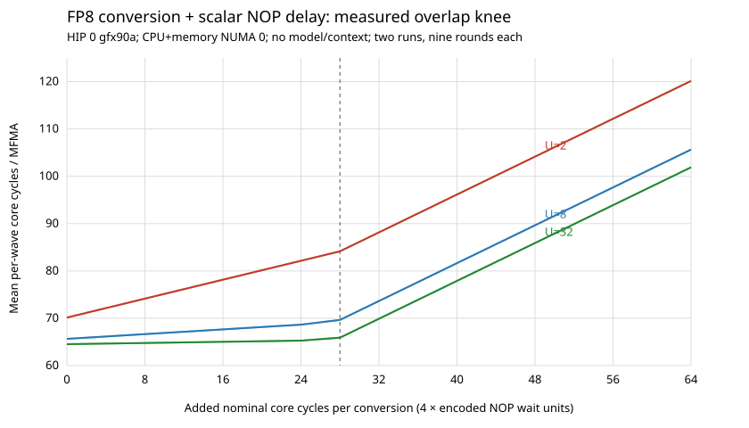

# NOP-window sweep: the loop-backedge hypothesis holds

User-directed follow-up to the register-only W8A16 prototype. We insert a
controlled scalar NOP delay **after every eight-VALU conversion and before
MFMA on the previous operand bank**, then vary MFMAs per loop backedge.
The original `probe.hip` and its measured executable are unchanged.

**Result:** the predicted two-regime behavior reproduces almost exactly.
Initially only one delay per backedge is exposed: per-MFMA slope is 1/U,
where U is MFMAs/backedge. Around **24–28 added nominal core cycles**, that
regime ends; by **32 added cycles**, the slope is essentially **1 additional
core cycle/MFMA per additional core cycle of delay**.



## Placement and code-generation controls

`sweep_kernel<Delay,U>` implements the same eight VALUs and alternating banks
as the accepted register probe, one dependent FP32 accumulator chain:

```text
repeat U times per backedge:
    next = eight-VALU FP8 -> FP16 conversion(packed_weight)
    inserted scalar NOP delay
    MFMA(activation, current_operand, accumulator)
    current_operand = next       // register-bank alternation, not a copy
```

The delay stays tied to the newly converted operand through read-write asm
constraints. Earlyclobber keeps current/next banks separate; compiler-only
machine scheduling barriers preserve conversion/delay/MFMA order.

`audit_nop_sweep.py` checks the actual executable-extracted gfx90a object for
**all 135 kernels**, not only source or aggregate counts:

- 44 delay settings spanning 0..96 encoded wait units (dense 0..12, then
  mostly even settings; exact list is in source/summary.csv), each at U=2/8/32.
  Plus three pure-FP16 no-conversion/no-delay controls.
- Every individual conversion/MFMA interval has precisely two permutes, two
  packed shifts, two ANDs, two packed multiplies, and exactly its requested
  NOP wait-state sum. No other vector operations inside these intervals.
- Exactly U MFMAs/backedge, no in-loop loads/stores, no scratch/private bytes
  and no LDS. Scalar loop-control/wait instructions remain explicitly allowed.
- All conversion variants have the same resource metadata: 28 VGPRs,
  16 AGPRs, 20 SGPRs; FP16 controls report 24 VGPRs, 16 AGPRs, 20 SGPRs.
- Twelve independent NOP-calibration kernels have exactly 32 delay instances
  per loop and no VALU/MFMA inside the timed loop.

For delays >16 encoded units, multiple `s_nop` instructions implement one
requested delay. The high-delay curve has small discontinuities when the
instruction count changes; the clean slope comparison uses the single-NOP
0..6 and 8..16 ranges. We do not interpret those discontinuities as a new
MFMA latency mechanism.

## Important unit calibration

**An encoded `s_nop` wait-state unit is not one core cycle on this box.**
`nop_clock.hip` separately times a scalar-NOP-only loop with 32 delay instances
per backedge, at both 1 CTA x 64 threads and 104 CTAs x 256 threads. Across
nine samples per point, and a repeat process, the measured slope is about
**4 core cycles per encoded wait unit** in both geometries.

For example, at 1x64, nominal wait counts 1/2/4/8/16 give approximately
5/9/17/33/65 core cycles per delay instance. Absolute values include the
amortized loop/timestamp overhead; the difference slope establishes the
4x mapping. The 104x256 geometry gives the same slope. No hardware clock
frequency assumption or event-time conversion is used for that mapping.

Consequently the table below uses **4 x encoded wait units** as its added
nominal core-cycle axis. This is a calibrated scale for this experiment,
not a claim that `s_nop IMM` is a portable wall-clock delay. In particular,
the earlier immediate-consumer correctness experiment's `s_nop 3` encodes
four wait units, roughly 16 core cycles on this machine, **not four core
cycles**. We did not establish minimum safe producer/consumer spacing there.

## Protocol

Native HIP O3/C++20, gfx90a, system ROCm 7.1 / Clang 21.1.8; no custom clock
or power settings. HIP device 0, MI250X GCD with 104 CUs, CPU and memory bound
to NUMA node 0. **No model or attention context.**

104 CTAs x 256 threads; 416 waves, nominal four waves/CU (not a measured
placement trace). Activations and weights are register-resident/invariant;
no timed operand streaming or LDS. Signed FP8 zero/subnormal/normal weights
and signed normal/zero FP16 activations match the original arithmetic probe.
The initial current operand is primed from pre-expanded data, and every
issued MFMA is paired with one conversion; the final prepared operand is
unused. Same bootstrap and workload for every delay variant.

Each kernel executes 4096 MFMAs/wave, U=2/8/32 per backedge. Warm every entry,
then condition with alternating zero-delay FP8 and FP16 kernels for >=2 s.
Nine randomized rounds with fixed seeds 1729 / 2718 in **two independent
processes**. Each sample is eight event-timed launches; mean per-wave
`clock64()` intervals from the last launch provide core cycles/MFMA, and
`wall_clock64()` provides effective-clock context. The CSV also retains
per-wave p10/p50/p90 and HIP-event throughput. The final timestamp does not
explicitly drain the last MFMA; this is a sustained-loop interval, not a
single-instruction completion-latency measurement.

Every output of every wave is checked against an independently indexed FP64
reference after every timed sample, outside timing. All **2430 timed
configurations** pass with **zero observed absolute error**. A separate
8192-step, three-round endpoint control passes all 405 configurations; its
slopes and knee are unchanged, with absolute cycles/MFMA about 0.075 lower.
That common endpoint offset is not the per-backedge effect.

Both retained calibration processes use the final build, with no overlapping
compilation or GPU measurement process. All GPU measurements are sequential.

## Results

Median core cycles/MFMA, process 1. Process 2 agrees to about 0.003 cycles
at these points; raw medians for both are in `results/nop-sweep/summary.csv`.

| Added nominal core cycles per conversion | U=2 | U=8 | U=32 |
|---:|---:|---:|---:|
| Pure FP16, no conversion/delay | 64.129 | 64.131 | 64.130 |
| 0 | 70.148 | 65.647 | 64.524 |
| 4 | 72.149 | 66.148 | 64.649 |
| 8 | 74.148 | 66.647 | 64.771 |
| 16 | 78.148 | 67.649 | 65.024 |
| 24 | 82.146 | 68.649 | 65.272 |
| 28 | 84.147 | 69.648 | 65.898 |
| 32 | 88.148 | 73.646 | 69.897 |
| 40 | 96.149 | 81.648 | 77.898 |
| 48 | 104.149 | 89.647 | 85.899 |
| 64 | 120.149 | 105.646 | 101.899 |

The initial slope (added delay 0..24 core cycles) and exposed slope (32..64):

| U | Initial measured slope, run 1 / run 2 | Expected 1/U | Exposed measured slope, run 1 / run 2 |
|---:|---:|---:|---:|
| 2 | 0.499932 / 0.500036 | 0.5 | 1.000042 / 1.000010 |
| 8 | 0.125068 / 0.124978 | 0.125 | 0.999993 / 0.999965 |
| 32 | 0.031159 / 0.031187 | 0.03125 | 1.000053 / 0.999946 |

These are core cycles/MFMA per additional nominal core cycle inserted at
**each** conversion. For U=8, adding 24 cycles per conversion raises
cycles/MFMA by about 3, or **24 cycles per eight-MFMA loop**, not 8x24.
For U=32 the same inserted delay raises cycles/MFMA by about 0.75, again
**24 cycles per loop**. Once exposed, the added delay costs at every MFMA.

Even at zero delay, the non-FP16 cost strongly depends on U: the FP8
numbers are consistent with ~12 extra cycles/backedge above a common
~64.15-cycle floor, plus small endpoint differences. This supports the
user's interpretation that the original ~66-cycle result is mostly an
amortized boundary effect, rather than two extra cycles intrinsically
required by every conversion/MFMA pair.

## Interpretation and limits

**The hypothesis holds:** one exposed boundary bubble initially, then every
interval becomes exposed. The unroll-dependent initial slopes make that
conclusion much stronger than an eight-MFMA-only sweep.

There is room for roughly **24 added nominal core cycles per conversion**
while paying essentially only one such delay per backedge. The transition
begins around 28; by 32 all intervals are in the near-one-for-one regime.
There is **not** a strictly flat zero-cost plateau for a finite-U loop:
even the first four-cycle delay increases the exposed boundary bubble.

This is consistent with the nominal 60-cycle coexecution window minus eight
four-cycle VALU instructions (~28 cycles), but does not prove precise
hardware issue/retirement timings or distinguish all possible branch versus
accumulator-forwarding mechanisms. It measures scalar issue-gap tolerance,
**not 24–28 guaranteed cycles of additional useful VALU or VMEM work**.
Loads, address generation, waits and additional dependencies still need their
own mixed-work measurement. No production changes or renewed attempt to
optimize away the accepted zero-delay gap is made.

The subsequent user-proposed [conversion-after phase rotation](ordering.md)
was implemented and checked. It preserves correctness but increases the
fitted boundary constant from ~12 to ~20 cycles; the original ordering
remains the reference. This does not identify the specific wait/branch cause.

## Reproduce / artifacts

```sh
bash research/fp8-w8a16/build-nop-sweep.sh
python3 research/fp8-w8a16/audit_nop_sweep.py
numactl --cpunodebind=0 --membind=0 temp/fp8-w8a16/nop-sweep/nop-clock
numactl --cpunodebind=0 --membind=0 temp/fp8-w8a16/nop-sweep/nop-sweep 4096 9 1729
# Second process: same command with seed 2718.
python3 research/fp8-w8a16/analyze_nop_sweep.py
```

Sweep stdout is CSV; stderr records device/protocol and validation status.
Redirect stdout/stderr to `results/nop-sweep/run{1,2}.{csv,log}` to replace
retained measurements deliberately. The analyzer reads those two retained
runs by default, checks completeness/zero error, and regenerates the summary
and dependency-free SVG. Sweep/calibration binaries, disassembly, extracted
loops and metadata are under `temp/fp8-w8a16/nop-sweep/`; source/binary/object
hashes, flags, audit, raw data and summary are retained under `results/`.
The original arithmetic probe's source, executable and object hashes still
match its existing recorded hashes. No engine sources/CMake files changed;
existing engine regression results remain those recorded in the main README.
